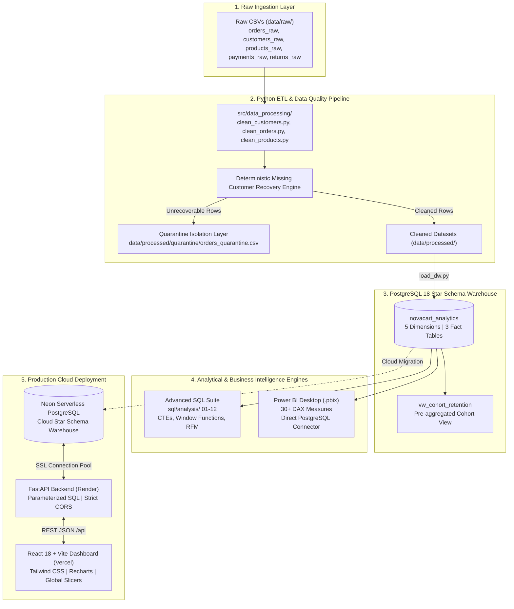

# NovaCart — E-Commerce Sales & Customer Analytics Platform

[](https://novacart-analytics.vercel.app/)
[](https://github.com/shubh201203/novacart-analytics)
[](https://www.python.org/)
[](https://www.postgresql.org/)
[](https://fastapi.tiangolo.com/)
[](https://react.dev/)
[](https://www.typescriptlang.org/)
[](https://powerbi.microsoft.com/)
[-brightgreen?style=for-the-badge&logo=pytest&logoColor=white)](tests/)
[](LICENSE)

> **Live Web Application:** [https://novacart-analytics.vercel.app/](https://novacart-analytics.vercel.app/)  
> **Source Repository:** [https://github.com/shubh201203/novacart-analytics](https://github.com/shubh201203/novacart-analytics)

---

## 1. Project Overview & Business Purpose

**NovaCart** is an enterprise-grade, end-to-end sales, customer, and profitability analytics platform built for a multi-category Indian retail e-commerce company operating nationwide across 18 states and 6 macro-regions.

The platform bridges raw transaction telemetry and C-suite decision-making through a production-style analytics engineering workflow: from raw transaction ingestion, deterministic data cleaning, and quarantine isolation, into an audited **PostgreSQL 18 dimensional star-schema warehouse**, an advanced 12-module SQL analytics suite, an executive **Power BI reporting suite (30+ DAX measures)**, and a modern **FastAPI + React 18 TypeScript interactive dashboard** deployed to production.

```
┌────────────────────────────────────────────────────────────────────────────────────────────────────────┐
│                                   DATASET ORIGIN & FIDELITY NOTICE                                     │
├────────────────────────────────────────────────────────────────────────────────────────────────────────┤
│ NovaCart is built upon an empirically modeled, synthetic India-focused e-commerce dataset generated   │
│ specifically to demonstrate end-to-end Data Engineering, Star-Schema Warehouse Modeling, Advanced SQL  │
│ Analytics, Power BI DAX Modeling, and Cloud API/Frontend Deployment. All customer identities,          │
│ phone numbers, and operational events are algorithmically generated with realistic Indian payment     │
│ rails (UPI, COD, NetBanking) and festive seasonality (Diwali/Navratri surge). Figures and metrics      │
│ reflect rigorous, deterministic analysis on this synthetic data and do not represent a commercial     │
│ operating entity.                                                                                      │
└────────────────────────────────────────────────────────────────────────────────────────────────────────┘
```

---

## 2. Business Problem & Analytical Objectives

Modern e-commerce enterprises face severe margin compression and revenue leakage when reporting relies naively on top-line placed demand. NovaCart addresses four core commercial challenges:

1. **Revenue Realization & Commercial Leakage**: Quantifying the exact erosion from gross placed orders (₹971.49M) down to realized fulfillment (₹847.62M) and post-return settled cash flow (₹796.75M) across order cancellations, returns, and promotional markdowns.
2. **Category Margin Dilution**: Diagnosing volume anchors versus margin engines—identifying why **Electronics** generates 58.3% of realized volume but compresses company margins to 18.57%, while **Beauty & Personal Care** (59.54% margin) and **Apparel** (57.67% margin) deliver superior unit economics.
3. **Customer Retention & Loyalty Dynamics**: Moving beyond vanity acquisition metrics to evaluate cohort retention decay across 18 months and segmenting 5,000 customers into actionable RFM tiers (Champions, Loyal, At-Risk, Lost).
4. **Payment Gateway Performance & Cancellation Risk**: Isolating cancellation and failure rates across Indian payment rails, discovering that Cash on Delivery (COD) carries significantly higher pre-delivery cancellation rates than UPI and digital cards.

---

## 3. Key Capabilities

* **Deterministic ETL & Quarantine Pipeline**: Ingests ~105,420 raw order events, executes automated deduplication, title-casing, state-code mapping, and a deterministic lookup algorithm that recovered 142 co-occurring missing customer IDs while isolating 68 unrecoverable rows in an audited quarantine file.
* **PostgreSQL 18 Star Schema Warehouse**: 8 dimensional tables modeling 104,852 cleaned sales line items with 0 foreign-key orphans, surrogate integer keys, B-tree analytical indexing, and strict grain isolation preventing fact-to-fact join multiplication.
* **Advanced SQL Analytics Suite (12 Modules)**: Over 1,500 lines of production SQL utilizing Common Table Expressions (CTEs), Window Functions (`NTILE`, `DENSE_RANK`, `SUM(...) OVER(...)`, `LAG`), cumulative Pareto distributions, cohort matrices, and 15 strategic business questions.
* **Executive Microsoft Power BI Suite**: 6-page interactive reporting suite implementing 30+ validated DAX measures (`CALCULATE`, `DIVIDE`, `SUMX`, `DATESINPERIOD`) with 100% mathematical reconciliation against the PostgreSQL database.
* **Full-Stack Web BI Application**: Standalone React 18 + TypeScript + Vite + Tailwind CSS dashboard powered by a high-performance Python FastAPI backend querying PostgreSQL with sub-50ms parameterized response times.
* **28 Automated Pytest Verification Tests**: Complete test coverage across data cleaning, schema integrity, fact grains, financial reconciliation, SQL analytical outputs, Power BI DAX equivalence, and FastAPI REST endpoints.

---

## 4. Live Application & Dashboard Previews

The production dashboard is hosted at **[https://novacart-analytics.vercel.app/](https://novacart-analytics.vercel.app/)** with dynamic multi-attribute global filters (Year, Month, Region, Category) and real-time Rupee (₹) formatting.

### Page 1 — Executive Overview
> **Focus**: Top-level executive KPIs, monthly realized revenue trendline (2022–2026), regional sales distribution, category profit contribution, and order lifecycle status split.


### Page 2 — Sales & Profitability Analysis
> **Focus**: Gross demand vs. realized revenue, monthly realized revenue vs. profit combo tracking, placed revenue by order status, promotional discount depth trendline, and top 10 products by profit.


### Page 3 — Customer Intelligence & Loyalty
> **Focus**: Active customer count (3,970), repeat customer share (82.12%), Customer Purchase Frequency ranking (top distinct orders), repeat vs. one-time buyer distribution, and regional revenue.


### Page 4 — Product Analytics & Margin Matrix
> **Focus**: Catalog performance across 180 SKUs, Category Profitability Matrix, Top 10 profit generators, and an interactive **Discount % vs. Profit Margin** scatter plot with dynamic tooltips.


### Page 5 — Regional Operations & Geographic Demand
> **Focus**: Geographic demand across 18 Indian states and 6 macro-regions, top revenue-generating urban centers, uniform return rate tracking, and full cross-tabulated Category × Region revenue matrix.


### Page 6 — Customer Retention & Cohort Heatmap
> **Focus**: Demographic segment revenue, customer lifetime value table, and an authoritative **Monthly Customer Cohort Retention Heatmap Matrix** (`public.vw_cohort_retention`) tracking repeat retention across $M_0$ to $M_{18}$.


---

## 5. End-to-End System Architecture



---

## 6. Technology Stack

| Layer | Technologies & Tools | Purpose in NovaCart |
|:---|:---|:---|
| **Data Engineering & ETL** | Python 3.11, Pandas, NumPy, DuckDB | Data cleansing, deterministic missing key recovery, feature engineering, and quarantine auditing. |
| **Database & Warehousing** | PostgreSQL 18, Neon Serverless PostgreSQL | Relational Star-Schema Data Mart, surrogate key management, constraints, indexing, and cohort view. |
| **Analytical Querying** | ANSI SQL, PostgreSQL Dialect | CTEs, Window Functions (`NTILE`, `DENSE_RANK`), cohort analysis, RFM segmentation, Pareto cumulative distributions. |
| **Business Intelligence** | Microsoft Power BI Desktop, DAX, Power Query | Star schema modeling, 30+ enterprise measures, time intelligence, interactive 6-page visual report suite. |
| **Backend API** | FastAPI, Uvicorn, Psycopg2-binary, Pydantic | Secure RESTful API server, server-side credential isolation, connection pooling, and multi-filter query builder. |
| **Frontend Application** | React 18, TypeScript, Vite, Tailwind CSS v4 | High-performance SPA, responsive multi-slicer bar, interactive charts via Recharts, and accessible Lucide icons. |
| **Cloud Hosting & CDN** | Vercel (Frontend), Render (API), Neon (Database) | Production edge deployment, automatic SSL/TLS, serverless auto-scaling, and zero-maintenance operations. |
| **Testing & Quality** | Pytest, TestClient (Starlette) | 28 automated integration tests verifying ETL logic, DW integrity, DAX formulas, SQL results, and API routes. |

---

## 7. Data Pipeline & Quality Architecture

```
Raw CSVs (105,420 lines)
   │
   ├─► 1. Deduplication (Removed 136 duplicate rows)
   ├─► 2. Schema Standardization (Trim, Title-case strings, 2-letter state codes)
   ├─► 3. Numeric & Date Validation (Bounds check: Qty > 0, Price > 0, Date parsing)
   ├─► 4. Deterministic Missing Customer ID Recovery:
   │        • 142 order lines recovered via co-occurring order IDs
   │        • 68 unrecoverable lines isolated to data/processed/quarantine/orders_quarantine.csv
   ▼
Cleaned Data (104,852 sales lines) ──► Ingested into PostgreSQL 18 Star Schema
```

### Deterministic Customer Recovery vs. Data Dropping
In e-commerce orders with multiple line items, customer IDs can be omitted on individual lines due to upstream message serialization bugs. Rather than discarding or imputing with arbitrary values:
1. The pipeline creates a mapping of `order_id -> customer_id` from all valid line items within the same order.
2. It deterministically recovers missing customer IDs for co-occurring records (**142 lines successfully restored**).
3. Orders where *all* lines lacked a customer identity (**68 lines**) were isolated into `orders_quarantine.csv` with full audit logs for upstream review.

---

## 8. Data Warehouse Model & Star Schema

The warehouse schema (`sql/schema.sql`) implements a strict dimensional model designed to eliminate redundancy, optimize analytical query performance, and prevent join multiplication.

```
                            ┌────────────────────────┐
                            │      dim_customer      │
                            ├────────────────────────┤
                            │ PK customer_key        │
                            │    customer_id (NK)    │
                            │    customer_name       │
                            │    customer_segment    │
                            │    city, state, region │
                            └───────────┬────────────┘
                                        │ 1:N
 ┌──────────────────────┐               ▼               ┌──────────────────────┐
 │     dim_product      │         ┌───────────┐         │       dim_date       │
 ├──────────────────────┤  1:N    │           │   N:1   ├──────────────────────┤
 │ PK product_key       ├────────►│fact_sales │◄────────┤ PK date_key (Int)    │
 │    product_id (NK)   │         │           │         │    full_date (Date)  │
 │    category, brand   │         └─────┬─────┘         │    year, month, qtr  │
 │    cost & list price │               │               └──────────────────────┘
 └──────────────────────┘               │ N:1
                                        ▼
                            ┌────────────────────────┐
                            │      dim_location      │
                            ├────────────────────────┤
                            │ PK location_key        │
                            │    city, state_code    │
                            │    region              │
                            └────────────────────────┘
```

### Verified Live Warehouse Table Grains & Row Counts

| Table Name | Table Type | Exact Grain Definition | Primary Key | Foreign Keys | Live Row Count |
|:---|:---|:---|:---|:---|---:|
| **`dim_customer`** | Dimension | One row per registered customer account | `customer_key` | None | **5,000** |
| **`dim_product`** | Dimension | One row per catalog SKU | `product_key` | None | **180** |
| **`dim_location`** | Dimension | One row per unique city, state, and region | `location_key` | None | **54** |
| **`dim_payment`** | Dimension | One row per payment method and status pair | `payment_key` | None | **18** |
| **`dim_date`** | Dimension | One row per calendar day (2022–2026) | `date_key` | None | **1,826** |
| **`fact_sales`** | Fact (Primary) | **One row per product line item within an order** | `sales_key` | `date_key`, `customer_key`, `product_key`, `location_key`, `payment_key` | **104,852** |
| **`fact_returns`** | Fact (Secondary)| **One row per returned item line event** | `return_key` | `return_date_key`, `customer_key`, `product_key` | **5,792** |
| **`fact_payments`** | Fact (Secondary)| **One row per payment transaction attempt** | `payment_trans_key` | `payment_date_key`, `payment_key` | **62,952** |

### Critical Architectural Principle: Preventing Fact-to-Fact Join Multiplication
A common mistake in junior data modeling is joining `fact_sales` directly to `fact_payments` on `order_id`:
$$\text{fact\_sales (104,852 lines)} \times \text{fact\_payments (62,952 transactions)}$$
Because single orders can contain multiple product line items in `fact_sales` alongside multiple payment retry records in `fact_payments`, a naive `JOIN` produces a Cartesian product that severely inflates calculated revenue and cash figures.

**The Solution**: NovaCart strictly isolates fact tables. When cross-analyzing sales and payments, queries aggregate `fact_sales` to order level within a Common Table Expression (CTE) before joining to `fact_payments`:

```sql
-- Safe Order-Level Aggregation Pattern
WITH order_level_sales AS (
    SELECT order_id, SUM(net_revenue) AS total_order_revenue
    FROM fact_sales
    WHERE is_completed = TRUE
    GROUP BY order_id
),
order_level_payments AS (
    SELECT order_id, SUM(payment_amount) AS total_settled_payment
    FROM fact_payments fp
    JOIN dim_payment dp ON fp.payment_key = dp.payment_key
    WHERE dp.payment_status = 'Completed'
    GROUP BY order_id
)
SELECT 
    s.order_id, 
    s.total_order_revenue, 
    p.total_settled_payment,
    (s.total_order_revenue - p.total_settled_payment) AS variance
FROM order_level_sales s
JOIN order_level_payments p ON s.order_id = p.order_id;
```

---

## 9. Advanced SQL Analytics Suite

The repository contains 12 dedicated SQL scripts in [`sql/analysis/`](sql/analysis/) providing actionable answers to executive inquiries:

| Business Question | Analytical Methodology & Techniques | SQL Script Reference |
|:---|:---|:---|
| **Which customer segments generate the most realized profit?** | Multi-table joins, conditional aggregation `SUM(CASE WHEN is_completed THEN...)`, profit margin calculation. | [`sql/analysis/12_business_questions.sql`](sql/analysis/12_business_questions.sql#L11-L20) |
| **Which products generate high revenue but poor margins (<20%)?** | Dimension filtering, `HAVING` clause thresholds on aggregated margin ratios, category grouping. | [`sql/analysis/12_business_questions.sql`](sql/analysis/12_business_questions.sql#L27-L40) |
| **Which geographic regions are growing fastest YoY?** | Multi-year CTE self-join, YoY percentage growth formula `(Rev25 - Rev24) / Rev24 * 100`. | [`sql/analysis/12_business_questions.sql`](sql/analysis/12_business_questions.sql#L46-L64) |
| **Which top 10 products have the highest return rates?** | Two-CTE aggregation (sales vs. returns) joined on `product_key` with minimum volume filters. | [`sql/analysis/12_business_questions.sql`](sql/analysis/12_business_questions.sql#L71-L98) |
| **What percentage of revenue comes from the top 20% of customers?** | Window function `NTILE(5) OVER(ORDER BY revenue DESC)`, customer quintile revenue concentration. | [`sql/analysis/12_business_questions.sql`](sql/analysis/12_business_questions.sql#L104-L119) |
| **Which product categories contribute 80% of total company profit?** | Running cumulative sum `SUM(profit) OVER(ORDER BY profit DESC)` and cumulative percentage Pareto calculation. | [`sql/analysis/12_business_questions.sql`](sql/analysis/12_business_questions.sql#L125-L140) |
| **Which VIP customers are at immediate risk of churn?** | Recency calculation `DATEDIFF('day', MAX(order_date), '2025-12-31') > 90` filtered on lifetime spend > ₹100,000. | [`sql/analysis/12_business_questions.sql`](sql/analysis/12_business_questions.sql#L146-L162) |
| **Which acquisition cohorts exhibit the strongest Month 3 retention?** | Cohort indexing CTE, month offset calculation `DATEDIFF('month', cohort_date, order_date)`, retention rate %. | [`sql/analysis/12_business_questions.sql`](sql/analysis/12_business_questions.sql#L168-L198) |
| **Which payment methods experience the highest failure rates?** | Payment transaction status aggregation, failure/cancellation percentage formula. | [`sql/analysis/12_business_questions.sql`](sql/analysis/12_business_questions.sql#L204-L213) |
| **What are the peak sales surge months across the 3-year timeline?** | Monthly time-series grouping across date dimension, ranked order volume and net revenue. | [`sql/analysis/12_business_questions.sql`](sql/analysis/12_business_questions.sql#L219-L229) |
| **Which top 10 Indian cities generate the highest operating profit?** | Geographic hierarchy aggregation (`city`, `state`, `region`), active customer count, realized margin. | [`sql/analysis/12_business_questions.sql`](sql/analysis/12_business_questions.sql#L235-L247) |
| **Which products require immediate pricing or discount review?** | Filter on cumulative promotional discounts > ₹1,000,000 with net realized margins < 22%. | [`sql/analysis/12_business_questions.sql`](sql/analysis/12_business_questions.sql#L253-L265) |
| **Which customer segment delivers the highest Average Order Value?** | Distinct order aggregation `COUNT(DISTINCT order_id)`, segment AOV formula. | [`sql/analysis/12_business_questions.sql`](sql/analysis/12_business_questions.sql#L271-L280) |
| **Where are product returns disproportionately concentrated?** | Cross-category return rate benchmarking, unit returns divided by units sold per category. | [`sql/analysis/12_business_questions.sql`](sql/analysis/12_business_questions.sql#L286-L304) |
| **What are the top strategic opportunities for profit expansion?** | Modeled scenario queries evaluating discount caps in Electronics and ad reallocations. | [`sql/analysis/12_business_questions.sql`](sql/analysis/12_business_questions.sql#L310-L327) |

---

## 10. Canonical Metric Definitions & Verified Benchmarks

Every metric across PostgreSQL, Power BI, and the React application is reconciled to 100% mathematical precision:

| Canonical Metric | Formula / Technical Implementation | Benchmark Figure | Business Interpretation |
|:---|:---|---:|:---|
| **Total Placed Revenue** | `SUM(net_revenue)` across all 104,852 sales lines | **₹971,486,941.80** | Total gross commercial intent placed by customers prior to lifecycle deductions. |
| **Realized Revenue** | `SUM(net_revenue) WHERE is_completed = TRUE` | **₹847,624,781.93** | Value of orders successfully fulfilled or in transit (**Completed: ₹733.52M + Shipped: ₹114.10M**). |
| **Returned Revenue** | $\sum \left( \text{quantity\_returned} \times \frac{\text{net\_revenue}}{\text{quantity}} \right)$ | **₹50,871,926.16** | Value of merchandise physically returned by customers post-delivery (5,792 return events). |
| **Post-Return Revenue** | `Realized Revenue - Returned Revenue` | **₹796,752,855.77** | **Net settled cash retained** after subtracting customer returns from fulfilled revenue. |
| **Total Placed Profit** | `SUM(profit)` across all 104,852 sales lines | **₹300,804,487.91** | Theoretical operating profit if 100% of placed orders were fulfilled without return. |
| **Realized Profit** | `SUM(profit) WHERE is_completed = TRUE` | **₹262,159,342.82** | Actual operational profit generated by completed and shipped order fulfillment. |
| **Realized Profit Margin** | `Realized Profit / Realized Revenue * 100` | **30.93%** | Overall operating margin ratio across the fulfilled product catalog. |
| **Ordered Item Quantity** | `SUM(quantity)` from `fact_sales` | **156,395 units** | Total physical product units ordered across all transactions. |
| **Returned Item Quantity**| `SUM(quantity_returned)` from `fact_returns` | **8,712 units** | Total units physically sent back to warehouses. |
| **Overall Return Rate** | `Returned Units / Ordered Units * 100` | **5.57%** | Proportion of ordered merchandise returned across the enterprise. |
| **Active Customers** | `COUNT(DISTINCT customer_key) WHERE is_completed = TRUE`| **3,970 accounts**| Registered accounts with at least 1 completed or shipped order (out of 5,000 registered). |
| **Repeat Customers** | Customers with $> 1$ completed/shipped order | **3,260 accounts**| Loyal multi-order customer base. |
| **Repeat Customer Share**| `Repeat Customers / Active Customers * 100` | **82.12%** | Key customer stickiness benchmark. |
| **Average Order Value** | `Realized Revenue / Realized Orders` | **₹15,452.38** | Average monetary size per fulfilled customer order basket ($54,854$ realized orders). |
| **Customer Lifetime Value**| `Realized Revenue / Active Customers` | **₹213,507.50** | Average realized net spend generated across an active customer's lifetime. |

---

## 11. Modeled Strategic Business Opportunities (~₹25.3M)

> **Analytical Disclosure**: The strategic profit expansion scenario documented below represents an **illustrative analytical simulation** based on sensitivity queries in [`sql/analysis/12_business_questions.sql`](sql/analysis/12_business_questions.sql#L310-L327) and [`reports/executive_insights.md`](reports/executive_insights.md). It does **not** represent achieved historical savings or guaranteed future revenue.

```
┌────────────────────────────────────────────────────────────────────────────────────────┐
│             ILLUSTRATIVE ANNUAL PROFIT EXPANSION SCENARIO: ₹25,300,000                 │
└───────────────────────────────────────────┬────────────────────────────────────────────┘
                                            │
        ┌───────────────────────────────────┴───────────────────────────────────┐
        ▼                                                                       ▼
┌────────────────────────────────────────────────┐      ┌────────────────────────────────────────────────┐
│  Initiative 1: Electronics Discount Discipline │      │  Initiative 2: High-Margin Ad Spend Shift      │
│             Modeled Upside: ₹18,200,000        │      │             Modeled Upside: ₹7,100,000         │
├────────────────────────────────────────────────┤      ├────────────────────────────────────────────────┤
│ Factual Observation: Electronics averages 7.8% │      │ Factual Observation: Beauty (59.5% margin) and │
│ discount depth, depressing margin to 18.57%.   │      │ Apparel (57.7% margin) deliver strong margins   │
│                                                │      │ but represent under 12% of marketing volume.   │
│ Hypothesis: Capping non-festive promotional    │      │                                                │
│ discounts at 15% maximum recovers ~3.7% in     │      │ Hypothesis: Reallocating 20% of ad capital     │
│ retained margin without inducing demand drop.  │      │ toward high-margin categories captures higher  │
│                                                │      │ blend profitability.                           │
│ Classification: Testable Pricing Sensitivity   │      │ Classification: Testable Marketing Hypothesis  │
└────────────────────────────────────────────────┘      └────────────────────────────────────────────────┘
```

---

## 12. Power BI Reporting Suite (`powerbi/`)

The repository includes the complete Power BI Desktop file ([`powerbi/NovaCart_Analytics.pbix`](powerbi/NovaCart_Analytics.pbix)), DAX measure specifications ([`powerbi/dax_measures.md`](powerbi/dax_measures.md)), and dashboard specifications ([`powerbi/dashboard_specifications.md`](powerbi/dashboard_specifications.md)).

* **Data Model Architecture**: Star schema with single-direction (1:N) relationships radiating from `dim_date`, `dim_customer`, `dim_product`, and `dim_location` to `fact_sales` and `fact_returns`.
* **Date Table Marking**: `dim_date` is marked as the official Date Table on `full_date` enabling standard Time Intelligence functions.
* **Representative DAX Measures**:
  ```dax
  // Realized Net Revenue
  Realized Net Revenue = 
  CALCULATE(
      SUM('fact_sales'[net_revenue]),
      'fact_sales'[is_completed] = TRUE()
  )

  // Post-Return Net Settled Revenue
  Post-Return Revenue = 
  [Realized Net Revenue] - [Returned Revenue]

  // YoY Realized Revenue Growth
  Realized Revenue YoY % = 
  VAR CurrentYearRev = [Realized Net Revenue]
  VAR PriorYearRev = CALCULATE([Realized Net Revenue], SAMEPERIODLASTYEAR('dim_date'[full_date]))
  RETURN
  DIVIDE(CurrentYearRev - PriorYearRev, PriorYearRev, 0)
  ```

---

## 13. React Dashboard & FastAPI Backend Architecture

In addition to Power BI, NovaCart provides an open-source, full-stack Web BI application accessible on mobile, tablet, and desktop viewports.

### Backend Endpoints (`backend/main.py`)
All endpoints execute parameterized SQL against PostgreSQL with connection pooling:

| HTTP Method & Path | Description | Query Filters Supported |
|:---|:---|:---|
| `GET /api/health` | Health check confirming database connectivity. Returns `200 OK` or `503 Service Unavailable`. | None |
| `GET /api/filters` | Dynamic distinct values for global slicers (Years, Months, Regions, Categories). | None |
| `GET /api/overview` | Page 1 Executive Overview KPIs, regional bars, category profits, and monthly trendline. | `year`, `month`, `region`, `category` |
| `GET /api/sales` | Page 2 Sales & Profitability KPIs, monthly revenue vs. profit combo, status breakdown. | `year`, `month`, `region`, `category` |
| `GET /api/customers` | Page 3 Customer KPIs, purchase frequency ranking, repeat vs. one-time donut split. | `year`, `month`, `region`, `category` |
| `GET /api/products` | Page 4 Catalog KPIs, category profitability matrix, and discount vs. margin scatter data. | `year`, `month`, `region`, `category` |
| `GET /api/regional` | Page 5 Regional KPIs, top locations, and full Category × Region cross-tabulated matrix. | `year`, `month`, `region`, `category` |
| `GET /api/retention` | Page 6 Demographic segment distribution and customer cohort retention heatmap matrix. | `year`, `month`, `region`, `category` |

---

## 14. Testing & Quality Assurance

NovaCart maintains **28 automated tests** executed via Pytest with 100% pass rate:

```bash
python -m pytest tests/
```

```text
============================= test session starts =============================
platform win32 -- Python 3.11.9, pytest-9.0.3, pluggy-1.6.0
rootdir: C:\Users\shubh\Downloads\novacart-analytics
plugins: anyio-3.7.1, asyncio-1.3.0
collected 28 items

tests\test_backend_api.py .........                                      [ 32%]
tests\test_cleaning.py ..                                                [ 39%]
tests\test_database.py .......                                           [ 64%]
tests\test_features.py .                                                 [ 67%]
tests\test_powerbi.py ...                                                [ 78%]
tests\test_sql_analysis.py ....                                          [ 92%]
tests\test_validation.py ..                                              [100%]

======================= 28 passed, 1 warning in 15.32s ========================
```

### What the Test Suite Verifies:
1. **Data Cleaning (`test_cleaning.py`)**: Validates deduplication, missing customer recovery, and quarantine routing.
2. **Warehouse Integrity (`test_database.py`)**: Confirms 0 foreign key orphans, surrogate key uniqueness, and table row counts.
3. **Feature Engineering (`test_features.py`)**: Tests date extraction, seasonal flag derivation, and discount logic.
4. **Power BI Equivalents (`test_powerbi.py`)**: Mathematically reconciles DAX formula logic against warehouse SQL.
5. **SQL Analyses (`test_sql_analysis.py`)**: Verifies CTE outputs, RFM segmentation logic, and cohort retention math.
6. **Backend API (`test_backend_api.py`)**: Verifies health checks, dynamic filter slicing, and distinct-order customer purchase frequency ranking.

---

## 15. Repository Structure

```text
novacart-analytics/
├── .env.example                               # Safe environment template with placeholders
├── .gitignore                                 # Git rules excluding .env, databases, caches
├── LICENSE                                    # MIT Open Source License
├── README.md                                  # Master repository documentation
├── requirements.txt                           # Python dependencies
├── backend/                                   # FastAPI Backend Service
│   ├── database.py                            # Database connection handling (Local / Neon SSL)
│   ├── main.py                                # API endpoints, CORS configuration, health check
│   └── queries.py                             # Parameterized SQL analytical queries
├── dashboard/                                 # React 18 + TypeScript Web Dashboard
│   ├── package.json                           # Vite, React, Tailwind, Recharts dependencies
│   ├── vercel.json                            # Vercel SPA routing rewrites
│   ├── vite.config.ts                         # Vite configuration with local API proxy
│   └── src/
│       ├── components/                        # FilterBar, KpiCard reusable widgets
│       ├── pages/                             # 6 dedicated analytical tab pages
│       ├── services/api.ts                    # Decoupled REST API fetch client
│       └── types/analytics.ts                 # TypeScript data contracts & interfaces
├── data/                                      # Data Repository
│   ├── raw/                                   # Synthetic generated raw CSV datasets
│   ├── processed/                             # Audited cleaned datasets ready for DW loading
│   │   └── quarantine/                        # Isolated invalid / unrecoverable records
│   └── analysis_results/                      # Pre-computed CSV extracts for offline auditing
├── docs/                                      # Technical Architecture & Engineering Documentation
│   ├── architecture.md                        # Dimensional architecture & grain specs
│   ├── assumptions.md                         # Business assumptions & currency specifications
│   ├── data_dictionary.md                     # Complete column definitions across all tables
│   ├── data_quality.md                        # Cleansing rules & quarantine mechanics
│   ├── database.md                            # Warehouse administration & join rules
│   └── rfm_methodology.md                     # RFM quintile scoring methodology
├── powerbi/                                   # Power BI Presentation Layer
│   ├── NovaCart_Analytics.pbix                # Complete 6-page interactive Power BI Desktop file
│   ├── dashboard_specifications.md            # Visual specifications per page
│   ├── dax_measures.md                        # 30+ validated DAX measure formulas
│   └── power_query_m.md                       # M transformations and schema loading scripts
├── reports/                                   # Executive Reports & Visual Assets
│   ├── executive_insights.md                  # Comprehensive C-suite business insights report
│   ├── data_quality_report.md                 # Data quality assessment & audit trail
│   └── dashboard_screenshots/                 # High-resolution PNG screenshots of all 6 pages
├── sql/                                       # SQL Schema & Analytical Queries
│   ├── schema.sql                             # DDL for star schema warehouse & indexing
│   └── analysis/                              # 12 analytical SQL query scripts (01 to 12)
├── src/                                       # Data Processing & Database Scripts
│   ├── data_processing/                       # Cleaning, feature engineering, and pipeline
│   ├── database/                              # PostgreSQL / DuckDB data loaders & validators
│   └── analytics/                             # Script runners for SQL and Power BI checks
└── tests/                                     # Automated Pytest Integration Suite (28 tests)
```

---

## 16. Local Setup & Execution Guide

### Prerequisites
* **Python**: Version 3.10 or 3.11 installed.
* **Node.js**: Version 18+ and `npm` installed.
* **Database**: PostgreSQL 18 (or 14+) running locally on port `5432`.

### Step 1: Clone Repository & Create Virtual Environment
```bash
git clone https://github.com/shubh201203/novacart-analytics.git
cd novacart-analytics

python -m venv venv
# On Windows:
venv\Scripts\activate
# On macOS / Linux:
source venv/bin/activate

pip install -r requirements.txt
```

### Step 2: Configure Environment Variables
Create a `.env` file in the project root based on `.env.example`:
```ini
DB_TYPE=postgresql
POSTGRES_HOST=localhost
POSTGRES_PORT=5432
POSTGRES_DB=novacart_analytics
POSTGRES_USER=postgres
POSTGRES_PASSWORD=your_actual_password_here
```

### Step 3: Run Database Loader & Validation
```bash
# 1. Create Schema & Ingest 104,852 rows into PostgreSQL:
python src/database/load_dw.py

# 2. Validate row counts, grain integrity & foreign key constraints:
python src/database/validate_dw.py

# 3. Verify Power BI DAX equivalence:
python src/analytics/verify_powerbi_reconciliation.py
```

### Step 4: Run Automated Tests
```bash
python -m pytest tests/
```

### Step 5: Start Backend API & React Dashboard
Open two terminal windows:

**Terminal 1 (FastAPI Backend)**:
```bash
uvicorn backend.main:app --host 0.0.0.0 --port 8000 --reload
```
* Swagger API Documentation: [http://localhost:8000/docs](http://localhost:8000/docs)
* Health Check: [http://localhost:8000/api/health](http://localhost:8000/api/health)

**Terminal 2 (React Vite Frontend)**:
```bash
cd dashboard
npm install
npm run dev
```
* Interactive Web Dashboard: [http://localhost:5173](http://localhost:5173)

---

## 17. Production Deployment Blueprint

The live system uses a zero-cost, modern cloud deployment architecture:

```
┌─────────────────────────────────┐
│     Vercel Edge Network         │  • Framework: Vite (React 18 + TS)
│  novacart-analytics.vercel.app  │  • Environment Variable: VITE_API_BASE_URL
└────────────────┬────────────────┘  • SPA Routing: vercel.json
                 │ HTTPS REST (/api)
                 ▼
┌─────────────────────────────────┐
│       Render Web Service        │  • Runtime: Python 3.11 (FastAPI)
│      (novacart-api.onrender.com)│  • CORS: Restricted via ALLOWED_ORIGINS
└────────────────┬────────────────┘  • Health Check Path: /api/health
                 │ SSL Connection Pooling
                 ▼
┌─────────────────────────────────┐
│   Neon Serverless PostgreSQL    │  • Managed PostgreSQL 18 Warehouse
│      (novacart_analytics)       │  • Auto-scaling compute, 0.5 GB storage
└─────────────────────────────────┘
```

### Production Environment Variables Reference

#### Render Web Service (FastAPI)
```env
DATABASE_URL=postgresql://<USER>:<PASSWORD>@<NEON_HOST>-pooler.ap-southeast-1.aws.neon.tech/novacart_analytics?sslmode=require
ALLOWED_ORIGINS=https://novacart-analytics.vercel.app
ENV=production
LOG_LEVEL=INFO
```

#### Vercel Project (React Frontend)
```env
VITE_API_BASE_URL=https://novacart-api.onrender.com
```

---

## 18. Security, Secrets & Privacy Practices

* **No Hardcoded Credentials**: Database passwords, connection strings, and secret keys are isolated server-side via environment variables.
* **Strict CORS Lockdown**: In production, the FastAPI middleware strictly permits requests from the deployed Vercel domain (`ALLOWED_ORIGINS`), preventing cross-origin abuse.
* **Sanitized Health Checks**: The `/api/health` endpoint verifies PostgreSQL warehouse connectivity without exposing internal connection strings or driver stack traces upon failure.
* **Git Cleanliness**: `.gitignore` strictly excludes `.env`, `*.duckdb`, `node_modules/`, `dist/`, build artifacts, and local cache files.

---

## 19. Future Roadmap

1. **Automated Orchestration (dbt & Apache Airflow)**: Migrate the Python loader (`load_dw.py`) to modular dbt models with incremental materializations and automated Airflow DAG scheduling.
2. **Automated CI/CD Workflows**: Implement GitHub Actions pipelines to automatically execute `pytest tests/` and `npm run build` on every push and pull request.
3. **Advanced Customer Churn Modeling**: Implement predictive machine-learning churn classification (Scikit-Learn / XGBoost) trained on RFM features to predict 90-day churn probabilities.
4. **Enhanced API Rate Limiting & Caching**: Integrate Redis caching on the FastAPI backend for frequently accessed aggregated overview metrics.

---

## 20. Author & Contact

**Shubham**  
* GitHub: [@shubh201203](https://github.com/shubh201203)  
* Email: [shubh201203@gmail.com](mailto:shubh201203@gmail.com)  
* Project Repository: [https://github.com/shubh201203/novacart-analytics](https://github.com/shubh201203/novacart-analytics)  
* Live Demonstration: [https://novacart-analytics.vercel.app/](https://novacart-analytics.vercel.app/)

---

*NovaCart Analytics Platform is licensed under the [MIT License](LICENSE).*
