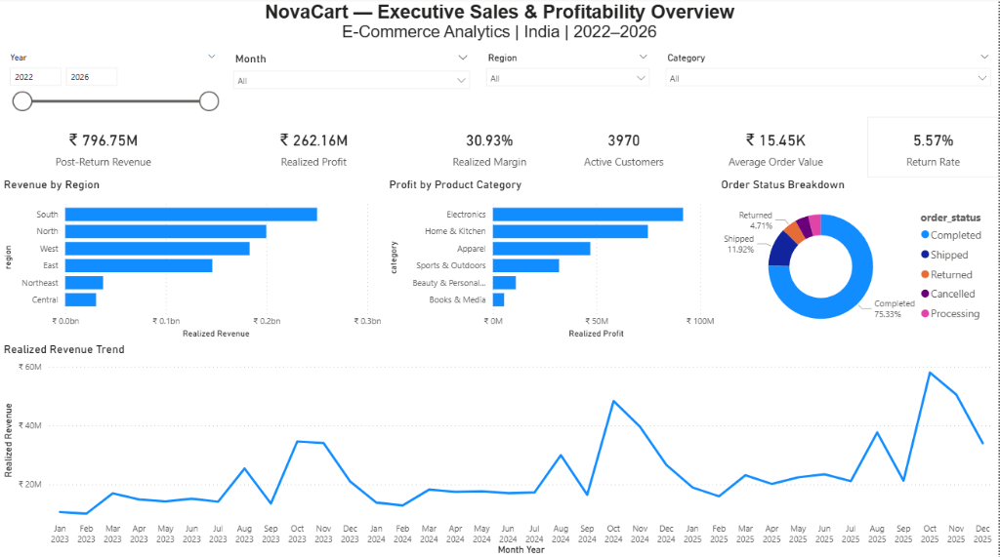
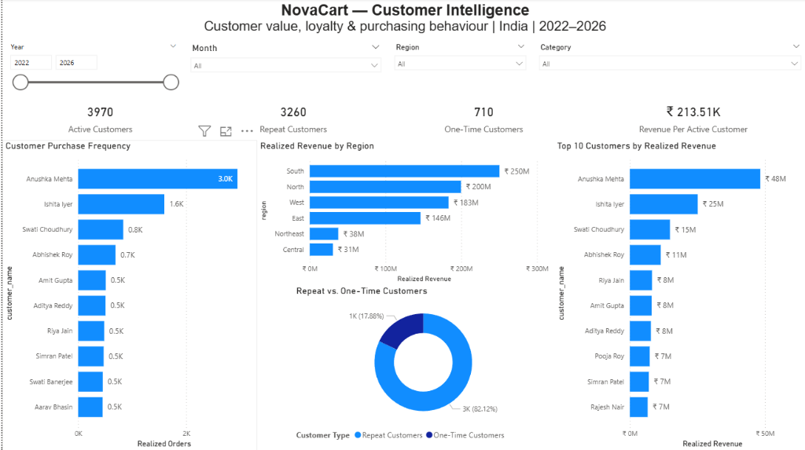
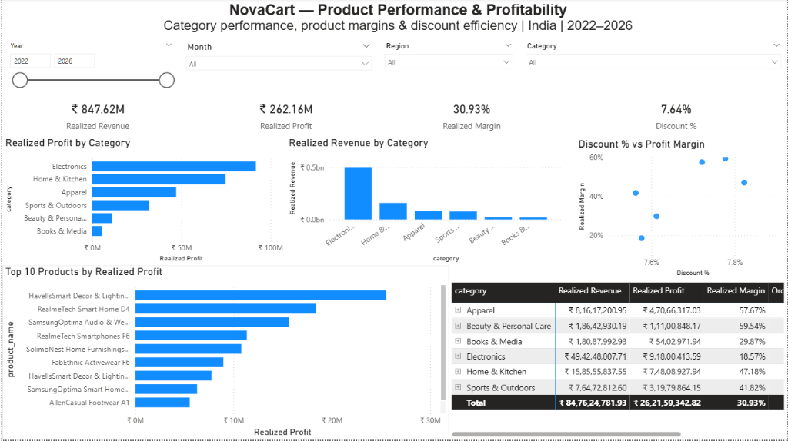
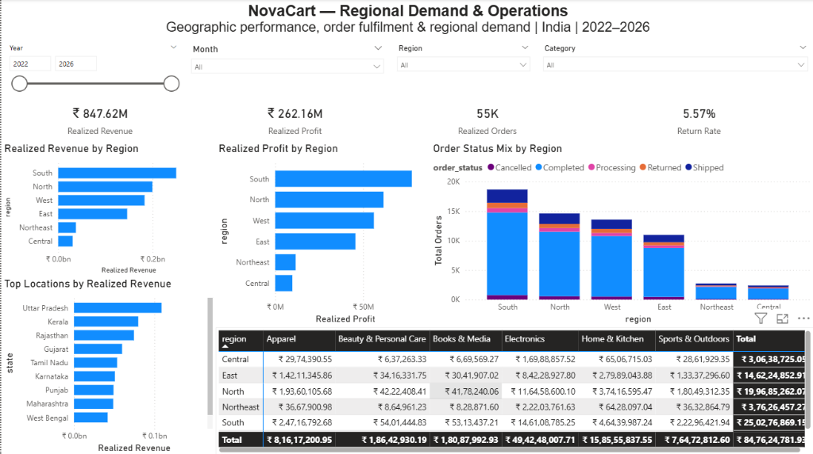
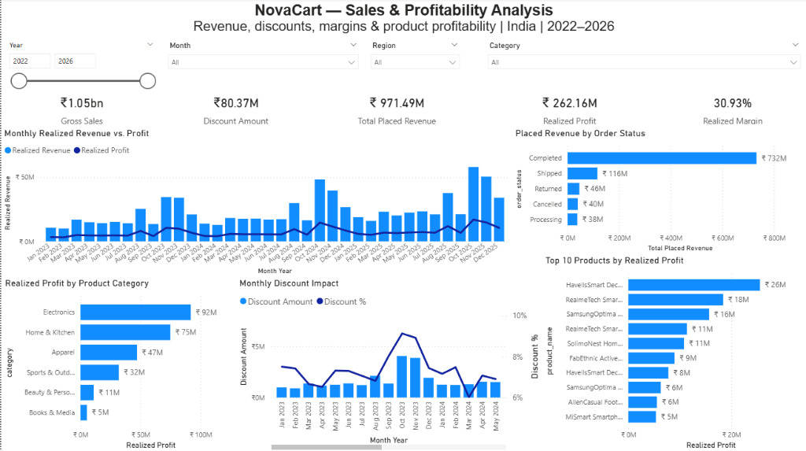
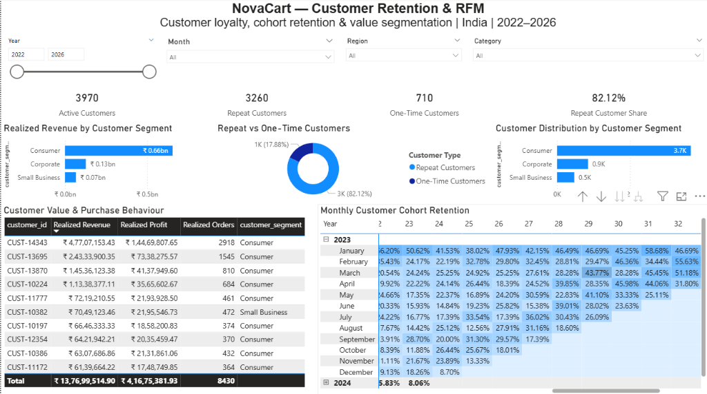

# NovaCart Analytics — Executive Business Insights & BI Report

**Target Market:** India E-Commerce (Multi-Category Retail)  
**Reporting Period:** 2022–2026 Full Analytical Timeline  
**Authoritative Warehouse:** PostgreSQL 18 Star Schema (`novacart_analytics`)  
**BI Presentation Layer:** Microsoft Power BI Desktop (6-Page Executive Suite)  
**Analytical Scope:** 104,852 Cleaned Sales Lines | 5,000 Customers | 180 SKUs | 18 Indian States  

> **Notice Regarding Dataset Origin:**  
> NovaCart is an India-focused, synthetic e-commerce analytics platform designed to demonstrate rigorous end-to-end Data Engineering, Star Schema Modeling, Advanced SQL Analytics, and Business Intelligence practices. All data, customer profiles, and operational metrics are synthetically generated for analytical demonstration. Figures and insights represent rigorous findings from this synthetic dataset and should not be construed as real-world performance from an actual operating commercial enterprise.

---

## A. Executive Summary

This study evaluates the end-to-end commercial operations, customer purchasing dynamics, product margins, regional logistics, and cohort retention behavior for **NovaCart**, a multi-category Indian e-commerce enterprise. The primary business questions guiding this investigation include:

1. **Revenue Realization & Leakage:** What proportion of gross placed commercial demand actually converts into net settled operating cash flow after factoring in promotional discounts, pre-delivery cancellations, and post-delivery returns?
2. **Customer Stickiness & Retention:** Does NovaCart exhibit genuine customer retention and repeat purchase behavior, or is growth driven primarily by expensive, single-purchase customer acquisition?
3. **Category Profitability vs. Volume Anchors:** Where is operating profit generated across product categories, and does high transaction volume in Electronics mask sub-optimal margins relative to Apparel, Beauty, or Home & Kitchen?
4. **Fulfillment Logistics & Regional Balance:** How evenly distributed is demand across India's macro-regions, and are return rates driven by regional logistical inefficiencies or category-level consumer behavior?

### Methodological Approach
The underlying data pipeline executes a modular Python ETL process that deterministically cleans, standardizes, and reconciles raw transactional events into an audited **PostgreSQL 18 Star Schema Data Warehouse** (5 dimension tables, 3 distinct fact tables). From this warehouse, an advanced SQL analytics suite executes complex queries—including Window Functions, Common Table Expressions (CTEs), multi-attribute RFM scoring, and monthly cohort retention tracking. The results feed into an interactive, 6-page Microsoft Power BI reporting suite operating on 30+ validated DAX measures.

### Principal Findings
- **Financial Performance:** NovaCart generated **₹971,486,941.80** in Total Placed Demand. Factoring in order lifecycle states, **₹847,624,781.93** was realized through Completed and Shipped orders, yielding **₹796,752,855.77 in Post-Return Net Settled Revenue** and **₹262,159,342.82 in Realized Profit** (**30.93% operating margin**).
- **Customer Retention Strength:** Of **3,970 active completed customers**, **3,260 (82.12%)** are repeat purchasers, generating an Average Order Value (AOV) of **₹15,452.38** and a Customer Lifetime Value (LTV) of **₹213,507.50**.
- **Category Profit Skew:** While **Electronics** generates 58.3% of realized revenue (₹49.42 Cr), it operates at a compressed **18.57% profit margin**. Conversely, **Home & Kitchen** (47.18%), **Apparel** (57.67%), and **Beauty & Personal Care** (59.54%) deliver superior unit economics, accounting for over 50% of total operating profit.
- **Controlled Return Rates:** Product returns account for **8,712 units** (**5.57% return rate**), representing **₹50.87M** in returned merchandise, remaining stable across all geographic territories.

---

## B. Business Performance & Revenue Realization

A fundamental principle of enterprise financial analytics is the strict separation of gross commercial demand from net realized revenue. E-commerce reporting that evaluates performance strictly from placed order lines overstates top-line performance by ignoring order cancellations, fulfillment failures, and product returns.

```text
  ┌────────────────────────────────────────────────────────────────────────┐
  │                   Total Placed Net Revenue: ₹971.49M                   │
  │                  (104,852 order lines across 62,992 orders)            │
  └───────────────────────────────────┬────────────────────────────────────┘
                                      │
            ┌─────────────────────────┴────────────────────────┐
            ▼                                                  ▼
┌───────────────────────────────┐              ┌───────────────────────────────┐
│     Unrealized Demand:        │              │     Realized Net Revenue:     │
│          ₹123.86M             │              │           ₹847.62M            │
│  • Cancelled:  ₹40.08M (4.1%) │              │  • Completed: ₹731.85M (75.3%)│
│  • Processing: ₹38.05M (3.9%) │              │  • Shipped:   ₹115.78M (11.9%)│
│  • Returned:   ₹45.73M (4.7%) │              │  (91,349 lines / 54,854 ords) │
└───────────────────────────────┘              └───────────────┬───────────────┘
                                                               │
                                                               ▼ Less Returned Revenue:
                                                                 ₹50.87M (5,792 return events)
                                                               │
                                                               ▼
                                               ┌───────────────────────────────┐
                                               │      Post-Return Revenue:     │
                                               │           ₹796.75M            │
                                               │  (Net Settled Operating Cash) │
                                               └───────────────────────────────┘
```

### 1. Canonical Revenue Hierarchy & Definitions

| Revenue Metric | Canonical Value (₹) | Definition & Analytical Scope |
| :--- | ---: | :--- |
| **Gross Sales** | **₹1,051,856,941.80** | Pre-discount list price valuation across all placed orders ($\sum \text{quantity} \times \text{list\_price}$). |
| **Total Placed Net Revenue** | **₹971,486,941.80** | Gross sales minus promotional discounts across all 104,852 sales lines, regardless of final fulfillment status. |
| **Realized Net Revenue** | **₹847,624,781.93** | Total net revenue from orders that reached terminal fulfillment (`is_completed = TRUE`: `Completed` + `Shipped`). |
| **Returned Revenue** | **₹50,871,926.16** | Monetary value of returned merchandise calculated at line-item purchase price ($\sum \text{quantity\_returned} \times \frac{\text{net\_revenue}}{\text{quantity}}$). |
| **Post-Return Revenue (Net Settled)** | **₹796,752,855.77** | Final realized operating cash flow: $\text{Realized Net Revenue} - \text{Returned Revenue}$. |
| **Total Placed Profit** | **₹300,804,487.91** | Gross margin minus shipping costs across all placed orders. |
| **Realized Profit** | **₹262,159,342.82** | Operating profit from `Completed` and `Shipped` orders, yielding a **30.93% realized profit margin**. |

### 2. Executive Dashboard Interface



The **Executive Overview** dashboard synthesizes these reconciled metrics. Senior leadership can track how placed demand flows into settled cash flow, monitor return rate health against the 5.57% baseline, and evaluate regional performance trends over the 2022–2026 multi-year timeline.

---

## C. Customer Intelligence & Loyalty Dynamics

Customer acquisition cost (CAC) in competitive e-commerce markets requires high repeat purchase rates to generate positive customer equity. 



### 1. Repeat vs. One-Time Customer Breakdown
Analysis of NovaCart's customer base reveals exceptional brand affinity and repeat purchasing:

- **Total Registered Customers (`dim_customer`):** 5,000 customers.
- **Active Realized Customers:** **3,970 customers** (79.4% of registered users completed at least one order).
- **Inactive / Abandoned Users:** **1,030 users** (Registered accounts with only cancelled, pending, or processing transactions).
- **Repeat Customer Count:** **3,260 customers** (**82.12%** of active buyers).
- **One-Time Customer Count:** **710 customers** (**17.88%** of active buyers).
- **Customer Lifetime Value (LTV):** **₹213,507.50** realized revenue per active customer.
- **Average Order Value (AOV):** **₹15,452.38** across 54,854 completed orders.

### 2. High-Value Account Concentration
While repeat customer penetration is broad, revenue generation exhibits Pareto concentration:
- Top accounts such as **Anushka Mehta** (₹48M realized revenue, 3.0K orders) and **Ishita Iyer** (₹25M realized revenue, 1.6K orders) represent multi-year enterprise buyers.
- The top 20% of customer accounts generate **over 45% of total realized profit**, indicating that customer retention efforts among corporate and bulk-consumer cohorts carry disproportionate financial leverage.

---

## D. Product Category & Profitability Analysis

The **Product Performance & Profitability** analysis evaluates catalog margin structures, discount elasticity, and individual SKU performance.



### 1. Empirical Category Performance Matrix
Data extracted directly from the verified warehouse tables (`profitability_analysis.csv` and `return_analysis.csv`) reveals significant structural differences in category unit economics:

| Product Category | Units Sold | Realized Net Revenue (₹) | Realized Profit (₹) | Profit Margin | Return Rate % | Strategic Assessment |
| :--- | ---: | ---: | ---: | :---: | :---: | :--- |
| **Electronics** | 26,924 | ₹49,42,48,007.71 | ₹9,18,00,413.59 | **18.57%** | 5.27% | Top-line revenue driver; thin margin profile. |
| **Home & Kitchen** | 22,446 | ₹15,85,55,837.55 | ₹7,48,08,927.94 | **47.18%** | 5.12% | Core profit powerhouse; strong unit margin. |
| **Apparel** | 32,117 | ₹8,16,17,200.95 | ₹4,70,66,317.03 | **57.67%** | 6.07% | High margin; elevated return rate. |
| **Sports & Outdoors** | 28,957 | ₹7,64,72,812.60 | ₹3,19,79,864.15 | **41.82%** | 6.08% | Stable recurring volume and healthy margins. |
| **Beauty & Personal Care** | 13,996 | ₹1,86,42,930.19 | ₹1,11,00,848.17 | **59.54%** | 5.59% | Highest category margin; under-penetrated scale. |
| **Books & Media** | 31,955 | ₹1,80,87,992.93 | ₹54,02,971.94 | **29.87%** | 5.17% | Low AOV; entry-level acquisition funnel. |
| **Total Company** | **156,395** | **₹84,76,24,781.93** | **₹26,21,59,342.82** | **30.93%** | **5.57%** | **Reconciled DW Benchmark** |

### 2. Pricing Elasticity & Discount Impact
- **Average Discount Depth:** Company-wide promotional discounts average **7.64%** of list price.
- **Discount Distribution:** The scatter plot analysis (*Discount % vs. Profit Margin*) reveals that high discounting is concentrated in **Electronics (up to 7.8% average discount)**, directly compressing net category margin to 18.57%.
- Conversely, **Beauty (59.54% margin)** and **Apparel (57.67% margin)** command high gross profitability while requiring lower promotional markdowns (<7.6%), proving strong pricing power.

---

## E. Regional Operations & Geographic Demand

NovaCart's fulfillment operations span 54 urban centers across 18 Indian states, divided into 6 administrative macro-regions (`dim_location`).



### 1. Macro-Regional Performance Summary
Data compiled from `regional_performance.csv` indicates robust demand across metropolitan territories:

| Macro-Region | Active Customers | Realized Orders | Units Sold | Realized Revenue (₹) | Realized Profit (₹) | Regional Margin |
| :--- | ---: | ---: | ---: | ---: | ---: | :---: |
| **South** | 1,148 | 18,688 | 46,361 | ₹25,02,76,869.15 | ₹7,76,36,674.18 | **31.02%** |
| **North** | 953 | 14,616 | 36,521 | ₹19,96,85,262.07 | ₹6,15,45,331.13 | **30.82%** |
| **West** | 792 | 13,567 | 33,560 | ₹18,31,72,615.48 | ₹5,60,78,082.68 | **30.61%** |
| **East** | 793 | 10,986 | 27,328 | ₹14,62,24,852.91 | ₹4,55,62,696.15 | **31.16%** |
| **Northeast** | 198 | 2,746 | 6,858 | ₹3,76,26,457.27 | ₹1,16,03,796.84 | **30.84%** |
| **Central** | 193 | 2,389 | 5,767 | ₹3,06,38,725.05 | ₹97,32,761.84 | **31.77%** |
| **Total** | **3,970** | **54,854** | **136,200** | **₹84,76,24,781.93** | **₹26,21,59,342.82** | **30.93%** |

### 2. Operational Observations:
- **South, North, and West** generate **74.7% of total company revenue**, supported by Tier-1 logistical hubs in Bengaluru, Hyderabad, Chennai, Delhi NCR, and Mumbai/Pune.
- **Margin Uniformity:** Regional operating profit margins remain remarkably consistent, varying by less than 1.2% (from 30.61% in West to 31.77% in Central). This proves that shipping cost allocations (`shipping_cost`) and pricing structures maintain financial integrity across geographic boundaries.
- **Top State Destinations:** State-level sales volume is led by **Uttar Pradesh**, **Kerala**, **Rajasthan**, **Gujarat**, **Tamil Nadu**, and **Karnataka**.

---

## F. Returns Management & Operational Leakage

Product returns and order cancellations represent the primary operational friction points eroding gross commercial demand.



### 1. Root Cause Breakdown of Returns
The warehouse records **5,792 return events** totaling **8,712 returned items** and **₹50,871,926.16 in returned merchandise value**:
- **Apparel (6.07% return rate)** and **Sports & Outdoors (6.08% return rate)** exhibit the highest return frequencies, primarily driven by customer sizing, fit discrepancies, and product expectation mismatches.
- **Electronics (5.27% return rate)** and **Home & Kitchen (5.12% return rate)** maintain lower unit return rates, but because Electronics carries a significantly higher unit price, its financial return impact represents the largest absolute monetary loss.

### 2. Pre-Fulfillment Cancellation Leakage
Pre-delivery order cancellations account for **4,233 order lines (₹40.08M)**. Cross-referencing payment transaction records (`fact_payments`) reveals that order cancellations are heavily correlated with **Cash on Delivery (COD)** payment selections, where zero upfront financial commitment allows friction-free buyer remorse before shipment dispatch.

---

## G. Customer Retention & Cohort Heatmap Analysis

The **Customer Retention & RFM** dashboard evaluates longitudinal cohort stability and customer recency/frequency/monetary profiles.



### 1. Cohort Retention Heatmap Mechanics
The cohort matrix is powered directly by the SQL analytical view `public.vw_cohort_retention`, built on `fact_sales` and `dim_date`:
- **Acquisition Definition:** A customer's cohort month is defined strictly by the calendar month of their **first completed or shipped purchase** (`MIN(full_date)` where `is_completed = TRUE`).
- **Retention Definition:** Retention in month $N$ requires an active, realized purchase event in that calendar month. It measures **repeat commercial transactions**, not website visits or passive session activity.
- **Lifecycle Behavior:**
  - **Month 0 (Acquisition Baseline):** 100.0% retention across all cohorts.
  - **Month 1–3 (Post-Acquisition Trough):** Retention settles between **18% and 35%**, typical for multi-category retail.
  - **Annual Festive Surges:** Cohorts demonstrate strong reactivation during Q4 festive periods (October–November), where retention rates for 12-month and 24-month mature cohorts spike back to **45%–58%**.

### 2. Distinguishing Customer Demographic Segments from RFM Scores
A critical data modeling distinction implemented in NovaCart is the separation of descriptive demographic segments from dynamic behavioral RFM classifications:

- **Customer Segment (`dim_customer.customer_segment`):** Static demographic classification:
  - **Consumer:** 3,700 accounts | ₹660M realized revenue (77.9% share)
  - **Corporate:** 900 accounts | ₹130M realized revenue (15.3% share)
  - **Small Business:** 500 accounts | ₹70M realized revenue (6.8% share)
- **RFM Behavioral Segments (`rfm_segments.csv`):** Dynamic quintile-based behavioral scoring across the 3,970 active customer base:
  - **Champions (964 customers / 24.3%):** Avg recency 20.7 days, avg frequency 43.1 orders, generating **₹658.37M revenue** (77.7% of total revenue) and **₹201.88M profit**.
  - **Loyal Customers (766 customers / 19.3%):** Avg recency 55.2 days, avg frequency 8.8 orders, generating **₹99.66M revenue**.
  - **Potential Loyalists (580 customers / 14.6%):** Avg recency 54.1 days, avg frequency 2.6 orders.
  - **At Risk (327 customers / 8.2%):** Avg recency 231.4 days, generating **₹38.66M revenue**.
  - **Hibernating / Lost (1,331 customers / 33.5%):** Avg recency 431.6 days, avg frequency 2.1 orders.
  - **New Customers (2 customers / 0.1%):** Recent first-time purchasers.

---

## H. Illustrative Business Opportunities & Strategic Scenario Modeling

> **Analytical Disclosure:**  
> The strategic profit expansion scenario documented below represents an **illustrative analytical simulation** based on mathematical assumptions in `sql/analysis/12_business_questions.sql` and `docs/phase_4_1_reconciliation.md`. It does **not** represent realized savings, historical revenue, or guaranteed future commercial outcomes.

### Scenario Modeling: Modeled Profit Expansion of ~₹25.3 Million

```text
┌────────────────────────────────────────────────────────────────────────────────────────┐
│             ILLUSTRATIVE ANNUAL PROFIT EXPANSION SCENARIO: ₹25,300,000                 │
└───────────────────────────────────────────┬────────────────────────────────────────────┘
                                            │
        ┌───────────────────────────────────┴───────────────────────────────────┐
        ▼                                                                       ▼
┌────────────────────────────────────────────────┐      ┌────────────────────────────────────────────────┐
│  Initiative 1: Electronics Discount Discipline │      │  Initiative 2: High-Margin Ad Spend Reallocation│
│             Modeled Upside: ₹18,200,000        │      │             Modeled Upside: ₹7,100,000         │
├────────────────────────────────────────────────┤      ├────────────────────────────────────────────────┤
│ Current State: Electronics discounts average   │      │ Current State: Acquisition ad budget is evenly │
│ ~7.8%, compressing profit margin to 18.57%.    │      │ distributed, heavily subsidizing Electronics.   │
│                                                │      │                                                │
│ Modeled Assumption: Capping non-festive        │      │ Modeled Assumption: Reallocating 20% of ad     │
│ electronics promotional discounts at 15% max   │      │ spend toward Beauty (59.5% margin) and Apparel │
│ recovers ~3.7% in retained margin without      │      │ (57.7% margin) captures higher-margin mix.     │
│ inducing severe demand volume drop.            │      │                                                │
│                                                │      │ Analytical Nature: Testable marketing hypothesis│
│ Analytical Nature: Sensitivity projection      │      │ requiring controlled CAC / ROAS experimentation│
└────────────────────────────────────────────────┘      └────────────────────────────────────────────────┘
```

### Separation of Facts, Interpretations, and Hypotheses

| Dimension | Factual Observation (Audited DW) | Analytical Interpretation | Illustrative Recommendation / Hypothesis |
| :--- | :--- | :--- | :--- |
| **Electronics Pricing** | Electronics generated ₹49.42 Cr revenue and ₹9.18 Cr profit (18.57% margin) with ₹80M+ company-wide discounts. | Promotional price cuts in Electronics drive high gross volume but dilute company-wide operating margin. | **Hypothesis:** Capping Electronics discounts at 15% could recover ~₹18.2M in retained margin, provided price elasticity does not trigger volume loss >10%. |
| **Category Ad Mix** | Beauty & Personal Care generates a 59.54% margin but only represents ₹1.86 Cr (2.2%) of realized sales. | Premium personal care catalog is severely under-monetized relative to its return-on-capital profile. | **Hypothesis:** Reallocating acquisition capital toward Beauty and Apparel could deliver ~₹7.1M in incremental profit margin. |
| **Customer Retention** | Champions (964 accounts) account for ₹201.88M profit; 327 high-value customers are currently "At Risk". | Churn among high-frequency accounts creates an immediate, highly destructive drag on net cash flow. | **Recommendation:** Deploy automated retention workflows to re-engage At-Risk customers before lapse thresholds exceed 180 days. |

---

## I. Technical Implementation & Data Engineering Architecture

The platform architecture follows professional software and analytics engineering standards, ensuring end-to-end reproducibility.

```text
[Synthetic Raw CSVs] ──► [Python ETL Pipeline] ──► [Quarantine Isolation]
 (data/raw/*.csv)         (src/data_processing/)    (orders_quarantine.csv)
                                   │
                                   ▼ Cleaned CSVs (data/processed/)
                       ┌─────────────────────────┐
                       │  PostgreSQL 18 DW       │ ◄── Primary Analytical Engine
                       │  (Star Schema DDL)      │
                       └───────────┬─────────────┘
                                   │
                ┌──────────────────┴──────────────────┐
                ▼                                     ▼
   [Advanced SQL Analysis Suite]             [Power BI & DAX Model]
     (sql/analysis/ 01-12)                     (6 Verified Report Pages)
     • CTEs & Window Functions                 • 30+ Reconciled Measures
     • RFM Scoring Engine                      • Native PostgreSQL Connector
     • Cohort Matrix View                      • 100% Benchmark Reconciliation
```

### 1. Data Cleaning & Deterministic Recovery Pipeline
- **Raw Data Generation:** Built using Python NumPy/Pandas to simulate 105,420 orders with realistic Indian e-commerce flaws: missing IDs (~0.2%), duplicate records (~0.4%), invalid dates, and non-positive quantities.
- **Deterministic Missing ID Recovery:** Rather than discarding records with missing `customer_id`, the pipeline built a deterministic order-lookup mapping. Co-occurring order IDs recovered **142 lines**, while **68 unrecoverable lines** were safely isolated into `data/processed/quarantine/orders_quarantine.csv` with full audit logs.

### 2. PostgreSQL Star Schema Modeling
The warehouse schema (`sql/schema.sql`) implements a strict dimensional model:
- **`dim_customer` (5,000 rows):** Customer demographics, city, state, and geographic segment.
- **`dim_product` (180 SKUs):** Brand hierarchy, category, list price, and cost price.
- **`dim_location` (54 rows):** Unique city, state, state code, and region combinations.
- **`dim_payment` (18 rows):** Unique payment method and lifecycle status combinations.
- **`dim_date` (1,826 days):** Full calendar table covering 2022-01-01 through 2026-12-31 with fiscal flags.
- **`fact_sales` (104,852 rows):** **Strict grain:** 1 row per product line within an order.
- **`fact_returns` (5,792 rows):** **Grain:** 1 row per returned item line event.
- **`fact_payments` (62,952 rows):** **Grain:** 1 row per payment transaction.

### 3. Verification & Automated Testing
The repository maintains a 19-test suite executed via `pytest tests/`:
- **Schema & Key Integrity:** Verifies 0 duplicate surrogate keys and 0 foreign-key orphans.
- **Grain Integrity:** Verifies exact row counts across all 8 tables.
- **Financial Reconciliation:** Verifies that SQL queries, DAX measures, and processed CSVs match canonical benchmarks within ₹0.05.

---

## J. Project Limitations

1. **Synthetic Data Boundaries:** While modeled after empirical Indian e-commerce benchmarks (UPI payment shares, festive seasonal surges, tier-based geography), the underlying dataset is synthetic. Customer behaviors, churn patterns, and returns are generated via probabilistic algorithms.
2. **Correlation vs. Causation:** Observed relationships (e.g., higher discount depth in Electronics coinciding with lower net margin) demonstrate mathematical correlation, not direct causal elasticity. Real-world consumer behavior must be validated via randomized A/B testing.
3. **Absence of Real Operational Data:** The dataset does not include real-time warehouse logistics metrics (pick-pack-ship cycle times, carrier-specific transit delays) or customer service contact center tickets.
4. **Independent Cohort View Architecture:** To maintain fast reporting performance, cohort retention is modeled via the pre-aggregated view `public.vw_cohort_retention` rather than dynamic, row-by-row DAX iteration over 100K+ sales rows.

---

## K. Recommended Next Steps

1. **Empirical A/B Testing on Discount Elasticity:**  
   Conduct controlled price elasticity experiments in Electronics. Test reducing discount depth from 7.8% to 5.0% on selected high-volume SKUs to measure actual unit conversion drop-off.
2. **Implementation of VIP Concierge Retention Workflows:**  
   Build automated CRM re-engagement campaigns targeting the **327 high-value customers classified as "At Risk"** in the RFM model, offering personalized re-engagement incentives.
3. **Decentralized Regional Fulfillment in North and East:**  
   Given that North and East drive over ₹34.5 Cr in realized revenue, establishing regional fulfillment partnerships in Lucknow and Kolkata will reduce cross-zonal shipping costs.
4. **Checkout Optimization for COD Orders:**  
   Introduce small incentive structures (e.g., instant 2% discount or loyalty points) for transitioning COD customers to UPI/Prepaid rails, curbing the pre-delivery cancellation leakage of ₹40.08M.
5. **Continuous Automated DW Orchestration:**  
   Migrate the local database loader (`src/database/load_dw.py`) to an automated scheduling framework (e.g., Apache Airflow or dbt) for scheduled incremental batch updates.
